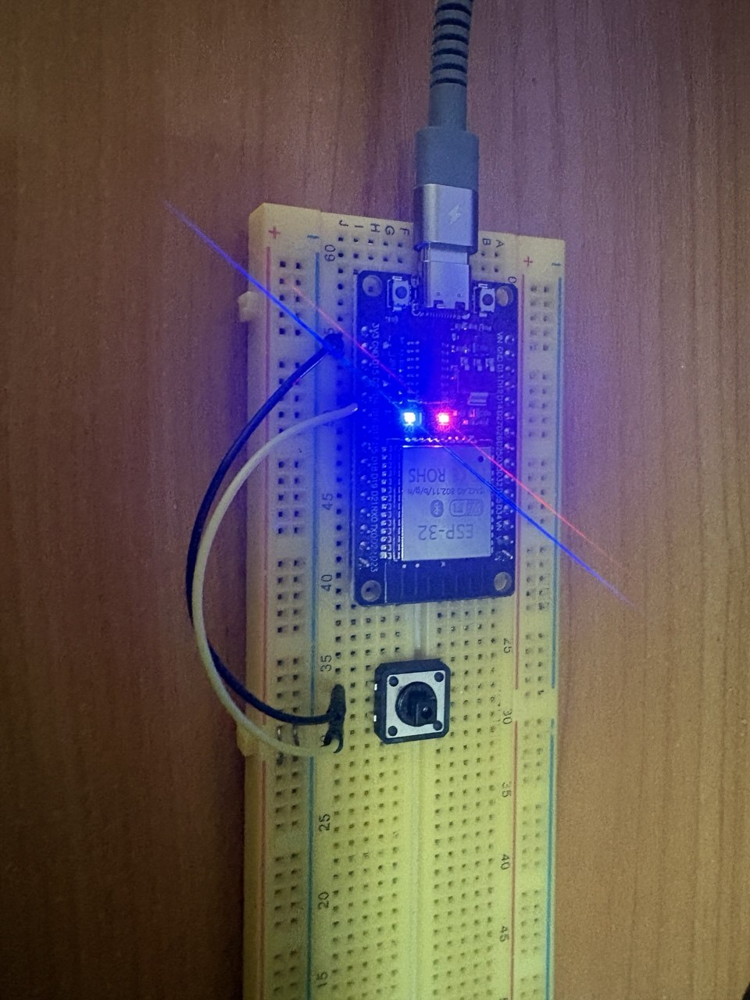
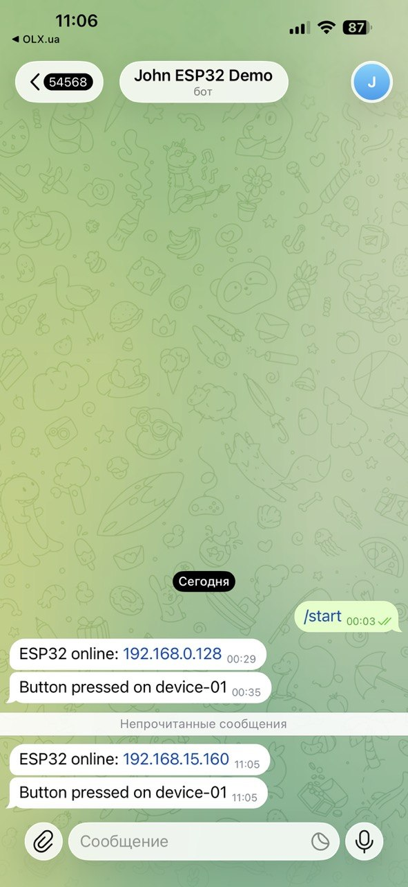

## Demo





## Files
| File | Role |
|------|------|
| `esp32-button-telegram.ino` | firmware: GPIO4 button → `sendMessage` |

## Hardware
- ESP32 DevKit
- Button: **GPIO4** ↔ **GND** (internal pull-up)
- Wi‑Fi **2.4 GHz**

## Flash
1. Create `secrets.h` next to the sketch:
```cpp
#pragma once
static const char *WIFI_SSID = "YOUR_WIFI_2G";
static const char *WIFI_PASS = "YOUR_PASSWORD";
static const char *BOT_TOKEN = "123456:ABC-DEF";
static const char *CHAT_ID   = "123456789";
